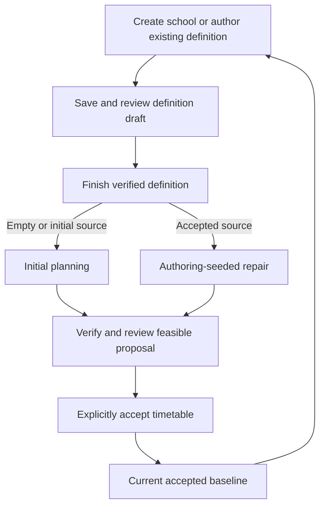

# School Kernel

School Kernel creates, inspects, and maintains school timetables. Its local browser workspace supports school-definition
authoring, initial planning, repair, and manual period/room editing, backed by a stateless planning CLI and a versioned
JSON contract.

The Java 25 Maven reactor has three modules: `kernel-contract` (schemas), `kernel-cli` (verification and scheduling),
and `timetable-workspace` (Spring Boot and PostgreSQL). A separate static viewer opens timetable result files.

## Requirements

- JDK 25. The Maven wrapper supplies Maven; an installed Maven must be version 3.9.x.
- Docker with Compose for the local workspace and PostgreSQL integration tests.
- Chrome for browser integration tests.

For a browser walkthrough, follow [Operations workspace](#operations-workspace). For command-line scheduling, build
the project and use the launcher below.

## Build

```bash
./mvnw clean verify
```

The build creates `kernel-cli/target/school-kernel.jar` and
`timetable-workspace/target/timetable-workspace-1.0.0-SNAPSHOT.jar`. The repository launcher uses the kernel artifact:

```bash
./school-kernel plan \
  --definition kernel-cli/src/test/resources/fixtures/initial-school.json \
  --output /tmp/timetable.json \
  --step-limit 100

./school-kernel replan \
  --current-definition kernel-cli/src/test/resources/fixtures/initial-school.json \
  --definition kernel-cli/src/test/resources/fixtures/updated-school.json \
  --current /tmp/timetable.json \
  --output /tmp/revised-timetable.json \
  --step-limit 100

./school-kernel verify \
  --definition kernel-cli/src/test/resources/fixtures/initial-school.json \
  --output /tmp/verification.json
```

`verify --successor --definition PATH --output PATH` verifies a complete successor definition without solving; it requires `basedOnRevision` and returns `SUCCESSOR_DEFINITION` evidence. The workspace independently verifies the accepted source and checks that lineage before finishing authoring.

The output file contains the only machine-readable result. Human diagnostics use stderr. Existing output is preserved
unless `--force` is supplied; replacement is atomic. `--time-limit` and `--step-limit` are mutually exclusive. The
default is a 30-second time limit and seed `0`.

Initial planning returns exit code `0` for `FEASIBLE`, `2` for `INVALID_INPUT`, `3` when no feasible timetable was
found, `4` for a safely handled internal error, `64` for command misuse, `74` for filesystem or publication failure,
and `130` for interruption before publication.

## Test checks

Run these commands from the repository root:

```bash
./mvnw test                         # Core unit, contract, and architecture tests; no Docker or browser
./mvnw -pl kernel-cli -am verify    # Core tests and packaged CLI integration tests
./mvnw -Pworkspace-api verify       # Core tests and PostgreSQL-backed workspace API integration tests
./mvnw -Pworkspace-browser verify   # Core tests and browser integration tests
./mvnw verify                       # All core and integration tests
```

The workspace profiles run the whole reactor so the packaged kernel is built before workspace integration tests.
Those tests require Docker; browser tests also require Chrome. For one integration class, use the reactor root and
allow modules with no matching class to pass:

```bash
./mvnw -Dit.test=FlywayFailureIT -Dfailsafe.failIfNoSpecifiedTests=false verify
```

Name core tests `*Test` or `*Tests`, packaged CLI tests `*CliIT`, and browser tests `*BrowserIT`. Other workspace
`*IT` classes exercise the API and database. Plain `verify` remains the full gate; `clean verify` also rebuilds from
scratch.

## Public contract

- [`school-definition-v1.schema.json`](kernel-contract/src/main/resources/schema/school-definition-v1.schema.json) defines inputs.
- [`result-v1.schema.json`](kernel-contract/src/main/resources/schema/result-v1.schema.json) defines planning outcomes.
- [`verification-result-v1.schema.json`](kernel-contract/src/main/resources/schema/verification-result-v1.schema.json)
  defines the non-solving import-verification outcome.
- Schema version `1` supports catalog versions `1` through `9`. Earlier catalogs remain readable for existing accepted
  results. Public demo schools and precomputed timetables live in `timetable-workspace/src/main/resources/demo/timetables/`.
- Definitions and timetable assignment state use RFC 8785 canonical JSON hashed with SHA-256. Revision IDs have the
  form `sha256:<lowercase-hex>`.
- A feasible result assigns every lesson once and satisfies the exact hard catalog in the specification.
- Optional `reservedPeriodIds` names declared school periods excluded from ordinary planning and repair. Period names or ID suffixes alone have no special meaning. A feasible
  result never assigns a lesson there unless its subject declares `reservedPeriodsAllowed` (catalog `6`). Omitting the
  field preserves existing definitions and results.
- Product scoring is lexicographic: feasibility, period stability, room stability, then ordinary preference penalty.
  Feasibility has two hard levels, physical conflicts first and day-shape rules (cohort gaps, start bounds, subject
  placement) second; both must be zero. Initial planning has zero stability penalties.
- Catalog `2` adds a penalty for each class gap inside an available school-day block and a penalty for weekly class
  loads that differ by more than one lesson. Catalog `3` adds one penalty for each taught class-day whose first lesson
  begins after the third regular slot (or third declared slot when none are reserved). Catalog `4` allows each cohort
  to declare `maxDailyLessonSpread`, the preferred maximum difference between its busiest and quietest available
  weekdays. Omitting it preserves the one-lesson default; exceeding it adds weekly-balance matches but does not make
  the timetable infeasible. Catalog `5` makes cohort gaps a hard constraint, `hard.cohort-gap`: each cohort-day may
  contain at most the cohort's `maxDailyGaps` gaps, which defaults to `0`. A gap-free timetable that cannot be found
  is reported as unsuccessful rather than published with gaps. Catalogs `1` through `4` place no hard limit on gaps,
  so their accepted results remain verifiable. A cohort gap
  is an empty available period between that cohort's first and last lesson of the day, not time before or after its
  lesson block. The late-start preference discourages first lessons after the third regular period; it does not
  compare start times within the first three periods.
  The preferences default to weight `1`; `softConstraintOverrides` can tune
  them from `0` through `1,000,000`. Workspace repair creates at least a catalog `8` successor while preserving its accepted
  predecessor, so a repair proposal also closes any gaps an older accepted timetable had. In repair, preferences choose among equally stable proposals; they do not authorize extra period or
  room moves solely to improve class quality.
- Catalog `6` adds per-cohort start bounds and per-subject placement rules. Slots count regular periods from `1` in
  declared order; reserved periods do not count as regular slots. A cohort's hard
  `latestStartSlot` makes a taught day that starts later infeasible (`hard.cohort-late-start`), and
  `preferredLatestStartSlot` replaces the late-start preference's third-slot threshold for that cohort. A subject may
  declare `reservedPeriodsAllowed`, `maxWeeklyReservedLessonsPerCohort`, `dayEdgeOnly` (each lesson is the cohort's
  first or last of the day), and `maxDailyLessonsPerCohort`; each is a hard rule. An occupied reserved period counts
  as part of the cohort's day for gaps.
- Catalog `7` adds a hard per-cohort `dailyLessonSpreadLimit` (`hard.cohort-daily-spread`). It uses the weekly-balance
  count with the limit in place of `maxDailyLessonSpread`, so a feasible timetable has no pair of available weekdays
  whose lesson counts differ by more than the limit. Omitting it imposes no hard limit, and `maxDailyLessonSpread`
  remains the preferred target.
- Catalog `8` lets a cohort declare its curator (`curatorTeacherId`) and home room (`homeRoomId`), and a subject
  declare `curatorLesson`. Each curator lesson must be taught by its cohort's curator, who needs no separate
  qualification for it, and is held in the cohort's home room when one is declared (`hard.cohort-home-room`). A
  lesson with no room preference of its own prefers the home room if the room can host it. A curator creates no
  lessons; a school adds Klassitund only where it wants one.
  Workspace repair upgrades older catalogs to `8` and preserves newer catalog versions.
- Catalog `9` adds top-level `roomAssignments`: each rule selects a subject and optionally a teacher, then declares
  non-empty `allowedRoomIds` or `useHomeRoom: true`. Every matching rule applies, so their allowed-room sets
  intersect. Empty intersections, missing matched home rooms, and conflicts with individual room locks or room
  requirements are invalid input. `hard.room-assignment` requires every matching lesson to use a permitted room in
  planning, repair, and independent verification.
- Catalog `10` adds explicit `adjacentToNext` on each teaching period and optional `consecutiveBlocks` rules
  (`id`, `cohortId`, `subjectId`, `length`, `operator: EXACTLY|AT_LEAST`, `weeklyCount`). Same-class/subject maximal
  runs of two or more require permission for that exact length, one teacher and room, and the declared weekly
  frequency. Ordinary breaks preserve adjacency; lunch boundaries interrupt it. Missing block rules forbid all
  consecutive runs. Mandatory valid blocks receive a bounded spreading exemption; extra At least blocks retain
  ordinary clustering cost. Catalogs 1–9 retain their original behavior and scores.
- A failed search returns diagnostics only. It never publishes a partial or hard-violating timetable and never claims
  infeasibility or optimality.

The complete behavior, constraint catalog, failure semantics, and score definitions are in
[`spec/kernel-v1/spec.md`](spec/kernel-v1/spec.md), with the catalog `2` quality extension in
[`spec/kernel-schedule-quality/spec.md`](spec/kernel-schedule-quality/spec.md) and the catalog `3` start-quality extension
in [`spec/kernel-cohort-start-quality/spec.md`](spec/kernel-cohort-start-quality/spec.md). The cohort-level spread
setting is specified in [`spec/kernel-cohort-daily-balance/spec.md`](spec/kernel-cohort-daily-balance/spec.md).
School-wide reservation behavior is in [`spec/kernel-reserved-periods/spec.md`](spec/kernel-reserved-periods/spec.md),
curators and home rooms are in [`spec/kernel-cohort-curator/spec.md`](spec/kernel-cohort-curator/spec.md), and
reusable hard room assignments are in [`spec/kernel-room-assignment/spec.md`](spec/kernel-room-assignment/spec.md).

## Operations workspace

The workspace binds to loopback and stores one versioned aggregate in PostgreSQL. Build once, then launch the packaged
application from the repository root:

```bash
./mvnw -q -pl timetable-workspace -am package
java -jar timetable-workspace/target/timetable-workspace-1.0.0-SNAPSHOT.jar
```

Spring Boot automatically runs `docker compose up` for the repository's PostgreSQL 18.6 service, waits for its health
check, applies Flyway, and stops the service when the application exits. Its named volume preserves the walkthrough
workspace across ordinary restarts. Open <http://localhost:8080/workspace/>.

### Create or import a school

In an empty workspace, choose **Create school** to author a new catalog 9 definition through forms. Alternatively,
import an initial definition, a matching definition/result pair, or an accepted-bundle ZIP. Import verification runs
through the packaged kernel. Try [`kernel-cli/src/test/resources/fixtures/initial-school.json`](kernel-cli/src/test/resources/fixtures/initial-school.json) for a small school or
[`full-definition.json`](timetable-workspace/src/main/resources/demo/timetables/full-definition.json) for the fictional Kasevälja school.

Use **Author definition** from an initial definition or accepted timetable to edit the existing school. Saved drafts
resume after reload or application restart. Authoring requires a viewport wider than 700 CSS pixels; narrower screens
show saved values for read-only inspection.

### Author and review a definition

The editor provides dedicated **School**, **Grid**, **Subjects**, **Teachers**, **Classes**, **Rooms**, **Room policies**,
**Weekly requirements**, **Occurrence details**, **Preferences**, and **Review** tabs:

- Configure school identity, scheduling catalog, weekly periods, reservations, subjects, teacher qualifications and
  availability, class rules, rooms, and room capabilities.
- Set weekly teaching counts and shared defaults; generated occurrences retain stable lesson identities. Customize
  individual occurrences, teaching responsibility, availability, and persistent period/room locks.
- Browse and filter records, requirements, room policies, and occurrences. Inspect the weekly grid spatially and use
  named references and linked issue controls to find the setting that needs correction.
- Define hard room policies and tune ordinary preferences with explanations and illustrative penalty calculations.
- Review saved changes, blocking issues, feasibility advisories, and timetable impact. Remove items with dependency
  guidance or restore source values and deleted source items.

Edits become durable only after explicit save; working form values are distinct from the saved draft. Leaving an
edited form offers **Save and continue**, **Discard working edits**, or **Stay**. One definition draft is active at a
time and locks competing planning, repair, manual-editing, import, replacement, and clearing actions until finished
or discarded. The accepted timetable (**Current**) remains available for inspection and export.

### Finish, plan, and accept

Choose **Finish verified definition** after reviewing saved changes. The packaged kernel verifies the complete
definition without solving a timetable. Blocking issues prevent finishing; feasibility advisories remain visible
but do not block it.



Finishing a new or initial school supplies an initial planning draft. Finishing from an accepted baseline supplies a
repair draft seeded with the authored successor definition. Generate a proposal, inspect its timetable and changes,
then explicitly accept it to advance Current. Workspace planning and repair use a one-minute search limit.

An unsuccessful or cancelled search retains the draft. Discarding a generated repair proposal retains repair intent;
abandoning an authoring-seeded repair returns to the saved authored definition. Discarding the whole authoring draft
restores its recorded source. Saving or finishing authoring never accepts a timetable automatically.

### Inspect and maintain Current

Inspect the accepted timetable in Week or Day views, with class, teacher, and room lenses. Stage teacher/room
unavailability and placement pins for repair, compare a verified proposal with Current, and explicitly accept changes.
Manual editing supports durable period and room changes, conflict explanations, and verified publication.

Change a lesson's teacher through definition authoring, using **Weekly requirements** or **Occurrence details**, then
finish, repair, review, and accept. Saved legacy manual teacher changes must be explicitly reverted or the manual
draft discarded before publication. Export Current as a ZIP containing `school-definition.json`,
`timetable-result.json`, and `workspace-manifest.json`; the bundle can be imported into an empty workspace.

All **27 school-definition authoring use cases are approved**, including the school-scale editor refinements. See the
[authoring status and evidence](spec/school-definition-authoring/status.md),
[latest editor regression and walkthrough evidence](output/playwright/school-definition-authoring/final-remaining-20261012/README.md),
and [feature specification index](spec/README.md) for detailed contracts and feature-specific approval status.

### Database configuration

To deliberately erase the local walkthrough database and start over:

```bash
docker compose down --volumes
```

The Compose credential is a well-known local-development value, not a production secret. Set
`SPRING_DOCKER_COMPOSE_ENABLED=false` and provide `WORKSPACE_DATABASE_URL`, `WORKSPACE_DATABASE_USERNAME`, and
`WORKSPACE_DATABASE_PASSWORD` to use an externally managed PostgreSQL instance.

## Timetable viewer

The dependency-free web viewer renders a result JSON by class, teacher, or room. Start a static server from the
repository root, then open <http://localhost:8081/ui/>:

```bash
python3 -m http.server 8081 --bind 127.0.0.1
```

The bundled Kasevälja precomputed Variant A loads automatically. Use **Open JSON** or drag another result
file onto the page to inspect it. On mobile screens, the weekly grid becomes a touch-friendly daily agenda.

## Performance measurement

The target-scale performance measurement is deliberately separate from correctness gates:

```bash
./mvnw -Pbenchmark test
```

It reports elapsed time for 1,000 lessons, 100 teachers, 60 cohorts, 100 rooms, and 60 periods without imposing a
shared-CI timing threshold.

### Run the timetable demo locally

Run `WorkspaceApplication` with IntelliJ's active profile set to `demo`, then open <http://localhost:8080/workspace/>.
The same profile works at <http://127.0.0.1:8080/workspace/> without certificates or proxy headers. With the default
loopback host configuration, it binds only to loopback and uses HTTP-compatible local session cookies. A configured
public hostname keeps the public HTTPS/proxy-origin checks and secure cookies. No database is needed for the demo.

Bundled timetables load directly from the packaged JSON. Startup performs no kernel verification or sample scoring;
explicit artifact maintenance performs those checks. School edits still validate on demand.

### Public demo school setup

Open **School setup** beside the timetable, then **New school** to start empty. Arrange the week, subjects,
classes, teacher eligibility/availability, rooms and class-owned weekly allocations. Review checks the exact draft
against the packaged kernel. **Save school copy** creates a named browser-local definition without solving.
Reopen its Review section to explicitly choose Quick/Thorough generation, inspect the candidate and save a named
timetable. Invalid work remains an independent recoverable setup draft.

JSON import/conversion, kernel export and transfer to the advanced buffer are explicit. Older definitions preview
catalog-10 adoption and compensating defaults/weights. **Download recovery** retains the complete authoring snapshot,
including unfinished work, named breaks/lunch and extended eligibility that kernel JSON does not carry. Local cleanup
in Utilities removes all saved artifacts and drafts and prevents stale tabs from restoring them.

Execution checkpoints and recorded browser/kernel evidence: [school setup status](spec/school-setup-editor/status.md).
