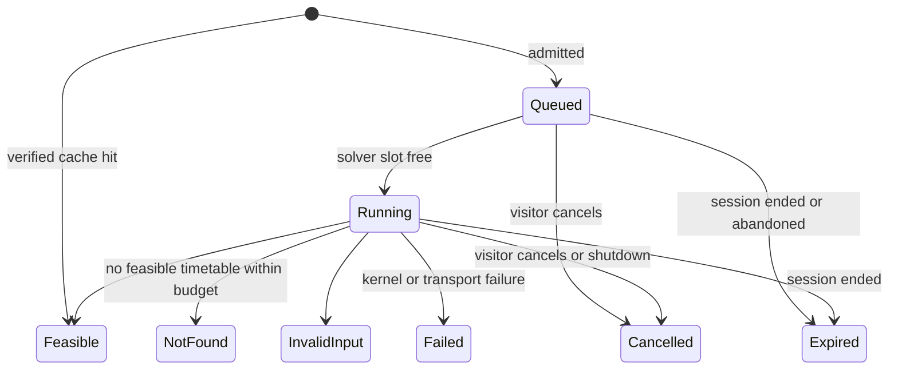

# Public Demo Deployment

## Status

Product understanding confirmed after proposal grilling on 2026-10-16 and recorded in [spec.md](spec.md).
This proposal describes a public, no-login deployment profile of the existing timetable workspace on the `demo` branch.
It does not change the approved local workspace, the kernel contract, or any
recorded use-case verdict until this feature is specified, implemented, converged, and approved. The section
[Relationship to existing specifications](#relationship-to-existing-specifications) lists the local-workspace rules that
the demo profile deliberately replaces.

## Purpose

School Kernel can already author a school, plan and repair a timetable, and let an administrator review and accept it.
Only someone who builds the project, runs Docker, and opens `localhost` can try any of this. Before investing in
accounts, durable hosting, or a hosted solver, we need to find out whether schools want the product at all. The
cheapest way to learn that is a public demo that anyone can open in a browser.

The demo is deliberately narrow:

- **One container, no database.** Each visitor's workspace lives only in memory and disappears after inactivity or a
  restart. Exporting the accepted timetable is how a visitor keeps their work.
- **Solving is an asynchronous job from the start.** New computation enters a bounded queue; each visitor's run
  returns its identifier immediately. One solver slot executes distinct jobs in order, and the browser shows each
  run's real status. The solving
  duration is a resource budget chosen from two presets, not something that happens inside an HTTP request.
- **Precomputed sample schools ship with the demo.** Three school definitions and verified timetables are bundled:
  a small synthetic school and pseudonymized copies of the two real-school definitions. Full school is preselected.
  Using a sample opens its accepted timetable immediately, ready for inspection, repair, and export.
- **Definitions are selected and edited as JSON, not authored.** A dropdown lists the bundled samples and the
  visitor's own saved versions, and a JSON editor shows the selected definition. An edited copy is saved under an
  identifier in the browser's local storage and joins the dropdown. The structured authoring forms are not part of
  the demo.
- **Reuse computation.** Identical requests reuse verified results from a bounded in-memory cache; simultaneous
  identical requests share one queued or running computation. Successful verification is reusable too. Each visitor
  still has a separate workspace, proposal, review, and acceptance.
- **Seams for later steps.** Workspace storage and solve execution sit behind interfaces. PostgreSQL, accounts, a
  second solver slot, or a hosted Timefold service can be added later without redesigning the workspace.

## Primary outcome

A visitor opens the stable Railway demo URL with Full school preselected. Selecting an entry only previews it;
**Use this sample** opens its precomputed timetable without solving. The visitor can inspect it, make repairs,
accept a new proposal, and export the result without an account. Alternatively, they edit a definition, save their
version in the browser, and use it to start initial planning with a **Quick** or **Thorough** search.

A reused result appears immediately with an explanation. New computation shows its queue position and approximate
start estimate, then elapsed time against the search budget and result verification. Global capacity and an upfront
kernel-time reservation bound new work; there are no per-address quotas. Railway Hobby supplies resource/spend
dashboards, and application logs explain queue, cache, and budget behavior. Staying within included usage is a cost
target to measure; the workspace-level Railway spending limit is the financial backstop, including across restarts.

## Current state and why it does not survive a public URL

The workspace was built as a local, single-administrator tool (see
[`timetable-workspace/rules.md`](../timetable-workspace/rules.md)). Each assumption below is safe on loopback and
wrong on the open internet:

| # | Current behavior | Consequence on a public URL | Demo response |
|---|---|---|---|
| 1 | Every service reads and writes the single PostgreSQL row `workspace_aggregate.workspace_id = 1`. | All visitors would share, see, and overwrite one school. | One ephemeral, in-memory workspace per browser session. |
| 2 | The listener binds to `127.0.0.1`. `HostOriginFilter` accepts only `localhost`, `127.0.0.1`, and `[::1]`. Forwarded headers are not trusted. | Railway's edge traffic is refused. | The demo profile binds `0.0.0.0:$PORT`, accepts only configured public hosts, and trusts the edge's `X-Forwarded-Proto`. |
| 3 | `InitialPlanningService` and `RepairPlanningService` each own a single-thread executor with an unbounded queue. Planning uses a fixed one-minute limit, and repair offers a two-minute retry. | Up to two concurrent solves, an invisible and unbounded backlog, and no fairness between visitors. | One global bounded queue, one solver slot, admission limits, and visible queue status. |
| 4 | `KernelVerifier` starts a kernel JVM synchronously for every import, acceptance, and authoring finish, and after every solve. Concurrency is unlimited. | A burst of imports starts many JVMs of about 0.2 GB each and can exhaust container memory. | Reuse successful verification of identical documents; bound and budget new verification processes. |
| 5 | While solving, the browser fetches `/api/csrf` and the complete `/api/workspace` snapshot every 300 ms. Responses are uncompressed. | For an MVK-sized school the snapshot is several hundred kilobytes (the definition alone is 209 KB). A minute's wait costs tens of megabytes of egress and serialization per visitor. | Poll a small run-status resource with backoff, fetch the snapshot once when the run ends, and compress JSON. |
| 6 | `examples/mvk.json` and `examples/mv5.json` carry 51 and 12 teacher names from a real school's published timetable: as display names, as name-derived identifiers, and as first names inside two room-assignment identifiers. | A public demo would spread real staff names further and tie them to a product. | Pseudonymized copies, bundled with the demo as selectable samples (see [Sample schools](#sample-schools)). The real-name files never enter the image. |
| 7 | When a time limit ends before construction has placed every lesson, the kernel returns `INTERNAL_ERROR` (`PlanService`: "Solver returned an incomplete candidate"). | A short Quick budget on a realistic school looks like a crash, not "no timetable found within this budget". | Kernel prerequisite: report this as `NO_FEASIBLE_SOLUTION_FOUND` with a budget diagnostic. |

## Hosting decision: Railway Hobby

The demo runs as **one service with one replica on Railway's Hobby plan**. It is built from a Dockerfile on the `demo`
branch and served on a Railway-generated domain kept stable for the lifetime of this demo. The service runs in an EU
region. Pro-only monitoring is outside scope.

### Why Railway fits

The Railway facts below were checked on 2026-10-16 against official pricing, documentation, and the staff
clarifications linked under [Observability](#observability) and [Privacy and data handling](#privacy-and-data-handling).

- **Long-running container.** A solve that continues after `202 Accepted` keeps its CPU. Request-scoped platforms
  throttle or stop work once the response has been sent.
- **Per-second usage billing.** Memory costs $0.00000386 per GB-second (about $10 per GB-month), and CPU costs
  $0.00000772 per vCPU-second (about $20 per vCPU-month). The $5 Hobby subscription includes $5 of usage, so an idle
  JVM and occasional solves may fit inside the subscription, subject to deployed measurements. See
  [Cost model](#cost-model).
- **Enough headroom.** Hobby allows up to 8 vCPU and 8 GB per replica. The Free plan's 0.5 GB per service is too small:
  one MVK solve child alone peaked at 0.6 GB resident memory (see [Evidence](#evidence)).
- **Spend protection.** Railway supports a workspace-level compute email alert and a hard limit (minimum $10),
  covering CPU, memory, storage, and network egress. Reaching the limit stops workloads across that workspace; this
  is not a demo-service-only limit. See [Cost control](https://docs.railway.com/pricing/cost-control).
- **Edge networking.** TLS terminates at Railway's edge, which documents `X-Forwarded-Proto: https`. The demo needs
  only the required scheme forwarding and a configured host allowlist. The documentation does not establish a
  blanket guarantee that every forwarded header overwrites client input; deployed spoof-header checks must prove
  the trust boundary. There is no client-address-based admission control. See
  [Networking specifications](https://docs.railway.com/networking/public-networking/specs-and-limits).
- **A path to persistence.** Railway can add a PostgreSQL service to the same project, reachable over private
  networking, when durable storage is justified.

### Platform constraints the design must respect

- **Every deploy or restart starts an empty container.** In-memory sessions, jobs, caches, and daily usage counters
  are lost. Packaged precomputed samples remain available after startup verification.
  The browser must recognize an ended session and say so plainly (see [Sessions](#sessions)).
- **Exactly one replica.** In-memory sessions and the queue are not shared, so a second replica would split visitors
  between unrelated states. Horizontal scaling waits for a shared store.
- **Serverless (sleeping) stays off at first.** A sleeping service stops 5 to 10 minutes after its last outbound
  traffic, and the first request after waking may return `502`. A visitor who is only reading a timetable sends no
  requests, so sleeping would erase their session mid-visit. The idle cost of staying awake is about $4 per month.
- **Healthchecks run only during deployment and arrive with host `healthcheck.railway.app`.** The health route must
  accept that host. Every other route keeps the strict host allowlist.
- **Config-as-code files are deprecated.** `railway.toml` and `railway.json` cannot be enabled for new services, and
  existing use ends on 2026-12-01. Service settings live in Railway Infrastructure as Code (`.railway/railway.ts`) or in
  the dashboard.

### Alternatives considered

| Option | Why not now |
|---|---|
| Google Cloud Run | With request-based billing, CPU is allocated only while a request is in progress, so a background solve after `202` is throttled. Instance-based billing removes most of the scale-to-zero saving, and autoscaling to several instances would split in-memory sessions. |
| Render | Fixed instance sizes. The free tier spins idle services down, which would erase in-memory sessions, and the small paid sizes leave little room for a web JVM plus a solver JVM. |
| Fly.io | A credible alternative with VM-style machines and EU regions. It brings more operational surface (machine sizing, auto-stop) for no clear gain at this size. |
| Small VPS | Lowest cost per vCPU and GB, but we would own OS patching, TLS, deployment, restarts, and monitoring for a hobby project. |
| Timefold Platform as the solver host | Not available yet: custom models are a partner-only preview (see [Hosted solver](#hosted-solver-timefold-platform)). |

## Scope

### Sessions

- On first use, the demo creates an ephemeral workspace bound to the existing HTTP session cookie (`HttpOnly`,
  `SameSite=Strict`, plus `Secure` in the demo profile). No URL contains a workspace identifier, and workspaces cannot
  be shared.
- A workspace expires 60 minutes after its last request or 8 hours after creation, whichever comes first, and on every
  restart or deploy. Polling counts as activity.
- At most 50 workspaces exist at once at first. When the limit is reached, new visitors see a "demo is full, try again
  later" page and no workspace is created. Existing sessions are not affected. The ceiling is configurable and must
  be lowered before launch if the largest supported workspaces do not fit the measured memory envelope.
- When a session has ended, the browser explains why ("This demo session ended after inactivity or a restart") and
  offers the definition dropdown, including the versions saved in this browser, and import of an exported bundle. It
  never shows a generic failure.
- A persistent banner states what the demo keeps and for how long: a timetable only through **Export**, and edited
  definitions in this browser until it clears them. The privacy note separately explains bounded shared-cache
  retention, which may outlive the originating session.

### Sample schools

The demo bundles three sample school definitions with precomputed, verified timetables, so a visitor can try
inspection and repair immediately without writing a definition or waiting for a solve. Every definition in the demo
starts from the dropdown: a visitor uses a sample as it is, edits its JSON and
saves their own version, or opens their own file in the editor (see
[Choosing and editing a definition](#choosing-and-editing-a-definition)). Importing an exported timetable bundle stays
available for continuing earlier work.

#### Bundled samples

| Sample | Identifier | Source | Size |
|---|---|---|---|
| Small school | `small` | `examples/initial-school.json` (already synthetic) | 2 lessons, 1 class, 1 teacher, 2 rooms, 3 periods |
| Two-class school | `two-class` | `examples/mv5.json`, pseudonymized | 42 lessons, 2 classes, 12 teachers, 13 rooms, 35 periods |
| Full school | `full` | `examples/mvk.json`, pseudonymized | 520 lessons, 23 classes, 51 teachers, 42 rooms, 50 periods |

- **Generated once, then maintained directly.** The pseudonymized files are generated once and committed. From then on
  they are the demo's source of truth and are maintained like any other definition. The build never derives them from
  the real-name files, so a later change to `examples/mvk.json` cannot leak names into the demo.
- **Packaged inside the workspace JAR.** The files are classpath resources of the workspace module, for example under
  `samples/`. A small catalog lists each sample's identifier, title, one-line description, and display order. The
  sizes shown to visitors are computed from the documents at startup, not maintained by hand. Neither packaged JAR
  contains any example file today, and the runtime image contains no `examples/` directory.
- **Current catalog version.** Samples are bundled at the kernel's current catalog version (9 today). The demo has no
  catalog-upgrade step, so this is what lets a visitor who edits a sample's JSON set every current preference. MV5
  (catalog 2) and the small school (catalog 1) are upgraded through the local workspace's existing catalog upgrade
  before they are committed. The upgrade can change solving behavior, so the launch gate measures the bundled files
  (see [Budget presets](#budget-presets)).
- **Precomputed results for all three samples.** Each sample includes its definition, computed result, and bundle
  metadata. They are generated after pseudonymization and catalog upgrade, verified with the shipped kernel, and
  packaged together. A build/launch check ensures current scoring evidence; results are regenerated when scoring
  changes, because verifying assignments alone does not establish that stored soft scores are current.
- **Available independently of the cache.** These are immutable packaged artifacts, not entries that disappear
  after the visitor-result cache's one-hour TTL or eviction. Startup verifies each definition/result pair before
  readiness. Loading a sample reuses that evidence and creates the visitor's own accepted baseline.

#### Pseudonymization

A scan of the source files on 2026-10-16 found personal or identifying data in these places:

| Location | `mvk.json` | `mv5.json` | Treatment |
|---|---|---|---|
| `teachers[].displayName` | 51 real names | 12 real names | Fictional names |
| `teachers[].id` (the name in lowercase with hyphens) | 51 | 12 | Derived from the fictional name, same convention |
| `lessons[].teacherId` | 520 references | 42 references | Follow the new teacher identifier |
| `cohorts[].curatorTeacherId` | 23 references | — | Follow the new teacher identifier |
| `roomAssignments[].teacherId` | 2 references | — | Follow the new teacher identifier |
| `roomAssignments[].id` | 7 identifiers with the school's abbreviation as prefix, 2 of them with a teacher's first name | — | Prefix dropped; first name replaced |
| `schoolId` and `displayName` | The real school | The real school | A fictional school identity |

Everything else stays: subject, class, room, period, and lesson identifiers and labels, and every scheduling field.
These carry no personal data. Someone who knows the school may still recognize its structure, which is already public
in the school's published timetable.

The fictional names follow these rules:

- They come from a committed pool of familiar demo-placeholder names, such as **John Doe** and **Jane Doe**, with
  enough distinct full names for every teacher. No source surname, and no source first-name and surname pair,
  appears in a bundled sample. School identities are fictional too.
- The mapping is one-to-one, so distinct teachers stay distinct and per-teacher constraints and diagnostics behave as
  before.
- The mapping keeps the alphabetical order of teacher identifiers, and the order of every array in the document is
  unchanged, so any processing ordered by identifier or by document position sees the same order as before.

At generation time, three checks are recorded as evidence. Before the catalog upgrade, the inverse mapping reproduces
the source exactly in canonical form. After it, kernel `verify` returns `VERIFIED` for each sample, and no source name
or name-derived identifier occurs anywhere in the output. A committed build test keeps the last guarantee: every
teacher display name in a bundled sample comes from the fictional pool, and, while the source files stay in the
repository, no source teacher name, surname, or identifier occurs in any bundled file or packaged JAR.

### Choosing and editing a definition

In the demo, a school definition is selected from a dropdown and edited as JSON. This replaces the structured
authoring forms (see [Authoring in the demo](#authoring-in-the-demo)). The definition panel is the main content of
the empty workspace, which is the first screen a new visitor sees. In every other state it is reachable from the
place where authoring is opened today.

#### Dropdown

- One dropdown lists two groups: **Sample schools**, the bundled samples in catalog order, and **Saved in this
  browser**, the visitor's own versions, most recently saved first.
- Full school is preselected for a new visitor. Preselection does not load a workspace or start a search.
- Below the dropdown, the selected entry shows the school's display name, its size (lessons, classes, teachers,
  rooms, periods), and the search preset that the size rule selects (see [Budget presets](#budget-presets)). A sample
  also shows its title and one-line description, which says that every person in it is fictional. A saved version
  also shows its identifier, when it was saved, and what it was derived from: a sample, another saved version, or an
  opened file.
- Selecting an entry only shows it. Nothing changes in the workspace until the visitor chooses **Use this sample**
  for a bundled entry or **Use this definition** for a saved version.
- The entry the workspace's definition came from is marked **In use**. The mark disappears when that saved version is
  replaced or deleted, or when an accepted repair changes the definition, for example through availability changes.
  After a bundle import, no entry is marked, and the panel says that the definition came from the imported bundle.

#### JSON editor

- The editor shows the selected entry's document exactly as stored: a sample as packaged, and a saved version exactly
  as the visitor typed it.
- It is a plain monospace text area. The workspace's content security policy (`script-src 'self'; style-src 'self'`)
  and its static, build-free UI rule out an editor loaded from a CDN, and common code editors inject styles at
  runtime, which this policy blocks.
- While the visitor types, the editor checks only JSON syntax. The kernel checks the school definition when it is
  used. A status line shows **Unchanged**, **Changed, not saved**, or the line and column of the first syntax error.
  Any difference from the stored text counts as a change, including whitespace, and **Revert** restores the stored
  text.
- **Open a file…** reads a local JSON file of at most 2 MiB into the editor as unsaved text. Nothing is sent to the
  server. This replaces importing one's own definition as a separate way to start.
- **Download** saves the editor's text as a JSON file. For a sample, the file also serves as a format example.
- Selecting another entry or opening a file while the editor holds unsaved changes asks whether to discard them.

#### Saving a version

- A change must be saved before it can be used. **Save as…** asks for an identifier and stores the editor's text in
  the browser's local storage. The new version then appears under **Saved in this browser** and is selected.
- An identifier has 1 to 40 characters: lowercase letters, digits, and hyphens, starting with a letter or a digit.
  The dialog suggests one: `full-1` for an edit of the Full sample, the current identifier for an edit of a saved
  version, or one derived from the name of an opened file. The sample identifiers `small`, `two-class`, and `full`
  are reserved.
- Saving under the identifier of an existing saved version replaces that version after a confirmation that names it.
  There is one version per identifier and no history.
- Saving requires text that parses as a JSON object and is at most 2 MiB in UTF-8, the demo's upload limit. It does
  not require a valid school definition, so unfinished work can be kept and corrected later.
- A saved version can be deleted after a confirmation, and **Delete all saved versions** removes them together.
  Samples cannot be changed or deleted.
- The identifier is a label for the visitor. It stays in the browser and is never sent to the server. It is
  independent of the document's `schoolId` and `displayName`, which the visitor edits in the JSON like any other
  field.

#### Using a definition

- **Use this sample** or **Use this definition** is available when the editor shows a stored entry without unsaved
  changes and no run is queued or running. Otherwise the button says what to do first: save the change, or wait for
  or cancel the run.
- If the workspace holds a current timetable, a proposal, or a repair or manual draft, a confirmation names what will
  be discarded and offers **Export** first. An empty workspace needs no confirmation.
- A sample is loaded by its identifier. The load reuses its precomputed timetable and startup verification and
  starts no kernel process (see [Server routes](#server-routes)). It enters `ACCEPTED_BASELINE`, ready to inspect,
  repair, and export; opening it does not count as the visitor accepting a generated proposal.
- A saved version is sent as its exact stored text. It goes through the same safe parsing and kernel `verify` as any
  uploaded definition, subject to the complexity gate and reusable verification evidence. A cache miss uses a
  bounded, budgeted verification slot (see [Admission control](#admission-control)). When
  the kernel reports `INVALID_INPUT`, the workspace is unchanged and the panel lists the kernel's validation errors
  with their locations in the document. The saved version stays as it is, so the visitor can correct it, save it
  again, and retry.
- Using a saved definition goes through the reset-and-import transition under the version guard and enters
  `INITIAL_DRAFT`, so the visitor can start planning. Sample and saved-definition loads both produce the visitor's
  own copy. Nothing a visitor does changes a bundled file, another visitor's session, or the versions saved in
  another browser.

#### Browser storage

- Each saved version is one local-storage entry under `school-kernel.definition.v1.<identifier>`, following the
  workspace's existing `school-kernel.inspection.v1.<schoolId>` preference key. Its value is a small envelope: format
  version, identifier, saved time, what it was derived from, and the document text exactly as typed.
- The browser also remembers which saved version it last used for the current workspace, so the **In use** mark
  survives a reload.
- Stored entries are read defensively. An entry that cannot be read is listed as unreadable and can only be deleted.
  Stored text is never interpreted as markup or code.
- MDN documents a limit of 5 MiB of local storage per origin. A formatted Full-school definition is about 210,000
  characters, so roughly 20 Full-sized versions fit, and fewer in a browser that counts two bytes per character. A
  small school takes a few kilobytes. When saving would exceed the limit, nothing is written, and the message suggests
  downloading and deleting older versions.
- Local storage is shared by every tab of one origin. Other open tabs refresh the dropdown when a version is saved or
  deleted.
- Saved versions outlive a demo session and a restart, but they are not durable. They belong to one browser on one
  device. Private windows discard them when closed, and clearing site data deletes them. Safari deletes a site's
  script-written storage when the site has had no user interaction in seven days of browser use. **Download** is the
  durable copy, and the panel says so.
- A different domain is a different origin, so versions saved on one domain do not appear on another. The
  Railway-generated domain stays stable for the demo; any future move requires downloading and reopening versions.

#### Server routes

- `GET /api/samples` returns the catalog with the computed sizes. `GET /api/samples/{sampleId}` returns a sample's
  document as packaged, for the editor and for **Download**. It contains no visitor data, so it is exempt from
  `no-store` and the browser revalidates it by its `ETag`.
- `POST /api/workspace/load-sample` with `If-Match` and a body such as `{"sampleId": "full"}` loads a sample. The
  browser never sends the document. The server reads only bundled resources and refuses an unknown identifier with
  `404 SAMPLE_NOT_FOUND`.
- At startup, the demo profile runs kernel `verify` once for each bundled definition/result pair and keeps its
  `VERIFIED` evidence: school identifier, catalog version, definition revision, and timetable revision.
  If any sample fails, the health route stays unhealthy, so the deployment fails and Railway keeps the previous
  deployment serving. A sample load reuses that result for the
  identical bundled bytes and does not compete for the verification slots.
- A saved version goes to the existing `POST /api/workspace/upload-definition` as its `definition` part, under a
  fixed file name, with an optional `origin` field: the sample the version was first derived from, or `file`. The
  identifier is not sent.
- The workspace records whether its definition came from a sample, and which one, or from the visitor, with that
  origin. The record is used only for the **In use** mark and for counts-only events.

### Authoring in the demo

The demo profile does not offer the structured authoring of
[`school-definition-authoring`](../school-definition-authoring/spec.md). The definition panel replaces it, for three
reasons:

- Authoring's central promise is saved work that survives a reload and a restart. The demo keeps no server state
  across restarts, so it could not keep that promise.
- Authoring is the largest stateful surface of the workspace: 28 routes, the `DEFINITION_DRAFT` lifecycle with its
  source tracking, and a draft document per workspace. Porting it to the in-memory store and exposing it publicly
  costs more than the demo's question justifies.
- The demo asks whether schools want generated timetables at all. Trying a sample, adjusting it, and bringing one's
  own definition answer that question. Whether visitors ask for forms is itself a signal (see
  [Validation](#validation)).

In the demo profile:

- The authoring routes, `/api/definition-draft/**` and `/api/repair-draft/return-to-authoring`, are not available and
  return `404`. The browser shows no authoring entry, and `DEFINITION_DRAFT` is unreachable.
- Creating a school from scratch, catalog upgrades, guided removal, source reverts, and seeded repair (authoring UC-1
  to UC-27) are not offered. A visitor who wants a new school edits a sample, for example the Small school, or opens
  their own file.
- Using a changed definition always starts over: the workspace is reset to `INITIAL_DRAFT`, and the next run is
  initial planning. Repairing an accepted timetable after a definition change, which the local workspace does through
  seeded repair, is not available. Repair with availability changes and pins stays.
- Where the workspace points to authoring today, such as the teacher-change guidance in manual editing (authoring
  UC-20), the demo points to the definition panel and says that using a changed definition starts a new timetable.

The default profile keeps authoring unchanged.

### Retained features

All current workspace capabilities except structured authoring remain: initial planning, repair with availability
changes and pins, manual period and room editing, proposal review, acceptance, and export and re-import of the
accepted bundle. The demo changes only what a public deployment requires, and simplifies definition handling:

- no durability, only session expiry
- bundled sample schools as the starting point (see [Sample schools](#sample-schools))
- a definition dropdown and JSON editor instead of authoring, with edited versions saved in the browser (see
  [Choosing and editing a definition](#choosing-and-editing-a-definition))
- solve budget presets instead of the fixed one-minute limit, and no two-minute repair retry
- queue status while waiting
- lower upload limits: 2 MiB for each JSON document and 5 MiB for an archive, compared with 10 MiB and 25 MiB locally.
  The full MVK definition is 209 KB.

Export covers only the accepted timetable. Saved definition versions outlive a session in the browser, but unfinished
repair and manual drafts do not, and the banner says so.

## Solving as jobs

### Budget presets

A visitor chooses one of two presets for every initial planning or repair run. The UI names them for their effort,
not their quality:

- **Quick search**: a few seconds; suitable for small schools.
- **Thorough search**: initially one minute, configurable up to two minutes if deployed measurements require it;
  gives larger schools more time to find a valid timetable and improve it. The UI displays the effective budget.

The copy says that more time often helps but guarantees nothing. Timefold is a heuristic search, and two runs on the
same input can differ because a time-limited search does as much work as the CPU allows.

Measured locally (see [Evidence](#evidence)), a budget is not the user-visible wait:

- A **1-second** limit is enough only for a toy school. MV5 needs about 1.25 s of construction in a fresh JVM, and MVK
  about 17 s, before any improvement begins. Below those times the run finds no complete timetable.
- The visible duration is the budget plus about 1 s of kernel overhead, about 1 s of JVM start and stop, the
  workspace's post-solve `verify` (about 2 s for MVK), and the time spent queued. These are observations, not enforced
  overhead bounds. A "1-second" run on the smallest school took 3.3 s before workspace verification.

The proposed initial values are **Quick = 5 s** and **Thorough = 60 s**. Both are configuration, not code. Thorough
starts at the workspace's current one-minute limit because Railway's vCPU speed has not been measured and MVK's
construction alone takes 17 s on a fast desktop. Timefold already accepts a duration budget, and the packaged kernel
supports `--time-limit 120s`; no new solver capability is needed. This budget covers construction and search,
not JVM startup, result verification, or queueing.

The launch gate runs real, cold computations on the deployed container with result and verification caches disabled.
It uses the bundled files at their bundled catalog version, not the source files measured in [Evidence](#evidence):

- Quick must produce `FEASIBLE` for the Small and Two-class samples in 5 of 5 consecutive runs.
- Thorough must produce `FEASIBLE` for the Full sample in 5 of 5 consecutive runs.
- Representative larger schools within the intended capacity target below must complete construction, produce
  verified feasible timetables, and fit memory limits. Start at 60 s; increase Thorough up to 120 s if required.
  If that still fails, revisit capacity before launch rather than silently reducing the target.

The default selection is Quick. For a school with more than a configurable number of lessons (initially 200), the
default becomes Thorough, and Quick carries the hint "usually too short for a school of this size". The same rule
applies to bundled samples: the Small and Two-class schools default to Quick, and the Full school to Thorough.
Loading a precomputed sample uses no search budget; its preset applies when the visitor later requests a solve.

### Supported problem size

Bytes remain an upload safeguard, but they do not estimate solver work. Apply two independent, configurable gates
before expensive kernel work on an uploaded definition or bundle:

- **Placement work estimate:** `W = lesson_count × planning_period_count × room_count`.
- **Lesson ceiling:** `lesson_count ≤ configured maximum`.

The model exposes global period and room ranges. Construction can examine their Cartesian product for each lesson;
teacher, cohort, availability, and pin constraints do not generally shrink those ranges beforehand. Some diagnostics
also compare lesson pairs, so the separate lesson ceiling matters. W is an admission proxy, not a runtime prediction
or a guarantee of feasibility. Teacher and cohort counts are still useful dimensions in benchmark fixtures and logs.

| Definition | Lessons | Planning periods | Rooms | W |
|---|---:|---:|---:|---:|
| Small | 2 | 3 | 2 | 12 |
| Two-class | 42 | 35 | 13 | 19,110 |
| Full (MVK) | 520 | 50 | 42 | 1,092,000 |
| Larger-school example | 2,160 | 50 | 80 | 8,640,000 |
| Same lessons and rooms, more periods | 2,160 | 60 | 80 | 10,368,000 |

Initial benchmark candidates are **W ≤ 11 million** and **at most 2,500 lessons**. They are provisional measurement
inputs, not validated launch limits. The intended target is up to 12 grades with 5–6 parallel cohorts (60–72 cohorts),
about 100 teachers, 70 or more rooms, and roughly 2,000–2,500 weekly lessons. Both gates must pass: for example,
2,500 lessons × 50 periods × 100 rooms is 12.5 million and exceeds the candidate W gate. Final thresholds must
describe the measured envelope explicitly rather than promising every combination of those dimensions.

Count safely after bounded parsing and before verification or solving; reject an oversized definition with a clear
size explanation and leave the workspace unchanged. Recheck the compiled solve input when a repair changes relevant
data. Validate construction, diagnostic/verification time, and memory at the boundaries on Railway before fixing
the launch values.

### Result and verification reuse

Reuse is enabled by default and can be disabled in the application's configuration file. There is no public force-fresh control.
An available **verified feasible** result is always reused for an identical request. Simultaneous identical requests
share one queued or running computation. Each visitor receives a separate run/proposal wrapper and retains their own
review and acceptance; the cache holds an immutable artifact, never another visitor's workspace state.

- Keys are computed by the server from canonical complete inputs, operation, actual time budget, seed and solver
  configuration, and kernel build. Canonicalization preserves array order: the existing definition revision sorts
  arrays, while the solver consumes their original order, so that revision alone is insufficient.
- Repair identity includes the accepted baseline definition and result and the compiled successor input, including
  pins and availability. A matching school definition alone is insufficient.
- Cache only results that passed local verification. Do not cache `NO_FEASIBLE_SOLUTION_FOUND`, cancellation,
  crashes, or transport failures.
- Visitor artifacts expire at most one hour after computation, with a fixed TTL rather than an access-based TTL.
  The cache initially has a configurable **64 MiB** ceiling, evicts earlier when full, and clears on restart. Bound
  successful verification evidence within that same memory allowance. Cache retention may outlive a session.
- Reuse successful verification only for identical complete documents, verification mode, and kernel build. Verify
  unseen or changed documents. A submitted hash, timetable revision, or `FEASIBLE` label is insufficient. Exact
  trusted evidence may avoid a new import or acceptance child process; workspace version and proposal identity
  checks still apply.
- The UI says when a result was reused. Original computation duration and provenance remain distinct from the new
  request's queue/wait duration. Cache hits and coalesced requests reserve no additional kernel time.
- Packaged sample artifacts and startup verification evidence are independent of visitor-cache eviction and TTL.

Visitors may exchange definition JSON or accepted result bundles outside the application. Importing a bundle safely
parses it, checks its size, verifies it or reuses exact trusted verification, and renders the accepted timetable
without solving. This provides file-based sharing without a shared workspace or accounts.

### Job lifecycle

A refused admission does not create a run. This is the visitor's lifecycle; several visitor runs may subscribe to
one physical computation. The workspace's existing `SOLVING_INITIAL` and `SOLVING_REPAIR` states cover both Queued
and Running. The run record adds the queue phase, position, and start estimate. Every existing guard still applies:
only the exact active run may write its workspace's proposal, and late or duplicate completions are discarded.

### Admission control

| Limit | Initial value | On refusal |
|---|---|---|
| Active runs per workspace | 1 (unchanged) | Existing `INVALID_WORKSPACE_TRANSITION` |
| Estimated wait for a new distinct computation | At most 2 minutes, configurable | `429` with `Retry-After` and "The demo is busy" |
| Distinct waiting computations | At most 8, plus 1 running | `429` with `Retry-After` and "The demo is busy" |
| Visitor-triggered kernel process time per UTC day | 4 hours, with upfront reservation | `429` with the daily-limit explanation |
| Concurrent kernel `verify` processes outside solve jobs | 2, waiting at most 10 s for a slot | `503` with a busy message |

Both queue gates must pass for new computation. Coalescing onto an existing job adds no queue entry. There are no
per-address quotas or counters. Refusals leave the draft unchanged, start no process, and disclose nothing about
other visitors.

The daily allowance counts elapsed time across **all visitor-triggered kernel processes**, including solve,
post-solve verification, standalone definition verification, imports, and acceptance verification. Overlapping
processes each consume time; this is neither solver-only time nor CPU accounting. Startup sample verification is
deployment work, not visitor work.

Reserve a conservative maximum before admitting a distinct solve, covering its process and required verification,
or before admitting standalone verification. Derive reservation sizes from enforced watchdog and cleanup bounds,
not typical startup overhead. Settle actual process elapsed time and release unused reservations on completion or
cancellation. Work already admitted must retain enough reserved allowance to finish its required verification;
another request cannot consume it first. Carry reservations across a UTC rollover until settled, without granting
the same allowance twice. Consumed/reserved/remaining reporting must reconcile with that policy.

Counters are in memory: a restart or deploy resets the guard, which is accepted for this demo. It is best-effort
daily control, not a durable financial ledger. At exhaustion, sample loading, cache hits, inspection, and export
remain available; new required kernel work waits for allowance to become available or the next UTC day. Railway's
monthly workspace spending limit remains the financial backstop.

### What the visitor sees while waiting

- **Queued**: "Position 3 — estimated start in about 2 minutes." The estimate uses the running computation's remaining
  budget, the distinct jobs ahead, and measured process/verification overhead. It is approximate, not an upper-bound
  guarantee, and is refreshed on every poll. A shared computation has one queue position for its subscribers.
- **Running**: elapsed time against the budget, then "Checking the result" once the budget has elapsed.
- The demo never promises a finish time. If a future executor cannot report a queue position, the UI shows "Queued"
  without a position.

### Cancellation, abandonment, and shutdown

- Cancellation immediately detaches that visitor's run. Other subscribers to the same computation continue.
- A queued visitor run whose session has not polled for 2 minutes expires before it reaches the solver slot.
  Session expiry detaches its queued or running requests too.
- If no subscribers remain, remove the queued computation or stop its running process: a graceful stop, then a forced
  stop after 2 seconds. Settle consumed time and release unused reservations. An already verified cached artifact
  remains available until its normal eviction or expiry.
- On `SIGTERM`, stop admissions, cancel running kernel processes, drop the queue, and release reservations. No jobs
  or sessions survive the restart.

### Polling

While a run is active, the browser polls a lightweight run-status resource (`GET /api/runs/{runId}` already exists)
about once per second. It backs off while queued and fetches the full workspace snapshot only when the run reaches a
final state. JSON responses are compressed.

## Technical direction (non-normative)

The following direction is input for `spec.md` and an optional `rules.md`. It is not yet binding.

1. **Deployment profile.** A `demo` Spring profile activates in-memory storage, public-edge networking, budget
   presets, admission control, and the definition panel, and turns structured authoring off. It disables the
   DataSource, Flyway, and Docker Compose. The workspace snapshot reports whether authoring and the definition panel
   are available, so one static UI serves both profiles. The default profile and the local PostgreSQL walkthrough
   stay unchanged.
2. **Workspace store seam.** Services depend on a store interface that captures today's conditional operations: load,
   versioned compare-and-set guarded by state and run, draft replacement, and recovery. `WorkspaceRepository` becomes
   the PostgreSQL adapter, still single-row. The in-memory adapter keys workspaces by session and serializes mutations
   under a per-workspace lock. It holds documents as canonical bytes to bound heap use and replaces the JSONB path
   queries in `loadRepairPinContext` with Java equivalents. Both adapters must pass the same contract test suite.
3. **Solve execution seam.** The interface is `submit → jobId`, `status(jobId)`, and `cancel(jobId)`, with admission,
   cache lookup, and coalescing in front of physical execution. Session-owned run IDs are distinct from shared
   computation IDs. Cancellation detaches a subscriber before deciding whether to cancel physical work. The first
   adapter retains today's `KernelPlanner` watchdog, private temporary files, and bounded output capture. Evidence
   checks compare the result's `limit` with the actual preset instead of fixed `PT1M`. A remote submit/poll adapter
   can be added later without changing visitor ownership.
4. **Local verification stays mandatory.** Every result needs local kernel `VERIFIED` evidence before it can become
   a proposal, whoever produced it. Exact successful evidence may be reused under the cache identity rules; this
   does not bypass version, proposal identity, or acceptance guards.
5. **The process boundary stays.** Each distinct uncached computation uses a child JVM. Heap limits help isolate
   child failures; avoiding a container-level out-of-memory kill also requires measured aggregate memory headroom.
6. **Explicit memory sizing.** Starting values to measure, not a proven capacity envelope:

   | Process | Heap | Basis |
   |---|---|---|
   | Web JVM | 768 MB | Sessions, cache, and concurrent request overhead to be measured |
   | Solve child | 768 MB | A 20 s MVK run peaked at 0.60 GB RSS |
   | Verify child | 384 MB | MVK verification peaked at 0.22 GB RSS |

   The `school-kernel` launcher needs a kernel-only JVM options variable, because `JAVA_TOOL_OPTIONS` would also
   apply to the web JVM. Start with a replica limit of **2 vCPU and 3 GB**. Measure the web JVM with the full cache,
   the largest permitted workspaces up to the session ceiling, one large solve, and two verification children.
   Include non-heap/RSS overhead. Existing MVK measurements do not establish that larger schools fit these heaps
   or that 50 largest workspaces fit the container. Adjust sizing and, if necessary, reduce the session ceiling
   before launch; revisit the capacity target if the largest schools cannot be supported.
7. **Container image.** A multi-stage Dockerfile builds with `./mvnw -pl timetable-workspace -am package` on JDK 25,
   which also runs the core unit, contract, and architecture tests. The runtime stage is a JDK 25 JRE image running
   as a non-root user. It contains the workspace JAR (with bundled definitions and precomputed results),
   `school-kernel.jar`, and the launcher, with `SCHOOL_KERNEL_EXECUTABLE` pointing at the launcher. It contains no
   `examples/` directory.
8. **Railway service settings.**
   - Dockerfile builder with auto-deploy from the `demo` branch
   - healthcheck `GET /healthz` (no school data, no session)
   - one replica in an EU region close to the first audience
   - Serverless off and restart on failure
   - managed through `.railway/railway.ts`
9. **Public-edge security.** The existing protections stay: CSRF, CSP, same-origin checks, `nosniff`, `no-store`, the
   route allowlist, and safe problem responses. Added in the demo profile:
   - a host allowlist from configuration (the Railway domain and any custom domain)
   - `healthcheck.railway.app` accepted for `/healthz` only
   - `X-Forwarded-Proto` trusted, `Secure` cookies, and HSTS
   - deployed checks for spoofed scheme/forwarded headers and strict host enforcement
   - the authoring routes removed from the route allowlist
10. **Observability.** Structured application events and periodic aggregate summaries, with Railway Hobby's built-in
    resource and spend views. See [Observability](#observability) for the logging contract and platform limits.

## Observability

Railway supplies service-level CPU, memory, disk, and network graphs with up to 30 days of metrics, plus current and
projected usage costs. These describe the service/container; application logs distinguish web, solve, and verification
activity. Resource-threshold monitors require Pro and are outside scope. Use Hobby's cost email/hard limit and
deployment/crash notifications. See [Metrics](https://docs.railway.com/observability/metrics),
[Project usage](https://docs.railway.com/projects/project-usage), and
[Deployment alerts](https://docs.railway.com/guides/alerts-crashes-failed-deploys).

Emit structured, single-line JSON on stdout/stderr:

- **Startup:** kernel/application build, effective capacity limits, search and process budgets, cache settings, and
  bundled-artifact verification outcomes.
- **Lifecycle:** session creation/expiry counts; admission/refusal with a safe reason; queue, start, finish, and
  cancellation; solve and verification outcomes and durations; queue wait; preset; sample identifier or custom
  origin; and safe complexity counts/buckets.
- **Reuse:** cache hits/misses and coalesced requests, distinguishing logical requests from physical computations.
- **Product use:** sample opens, custom definition use/origin, actual proposal acceptances, and bundle exports/imports.
  Opening a precomputed accepted sample is a sample-open event, not a user acceptance or conversion.
- **Every-minute summary, configurable interval:** active workspaces, distinct queue depth, running solve/verify
  processes, cache entries/bytes, and daily kernel time consumed/reserved/remaining. Include interval counts for
  admissions, refusal reasons, cache reuse, completions, and errors so aggregate review is practical.

Use computation/correlation IDs to connect work events. Do not put session IDs, cookies, saved-version labels, IP
addresses, personal names, or raw school documents into application logs. Do not log each poll. Any session-level
aggregate needed for conversion counts is calculated in memory and emitted as counts, without identifying visitors.

One summary per minute is **1,440 lines/day**, or **10,080/week**. At 1 KiB per line that is about **1.4 MiB/day**
and **9.8 MiB/week** of raw payload; 2 KiB lines double those figures. Other events add volume. Railway publishes a
500-lines/second/replica rate limit; no total log GB quota or separate per-byte log price was found in the reviewed
documentation. This volume is modest, but the absence of a published storage quota is not an unlimited-storage
promise. Stdout logs do not consume a Railway volume; the Hobby volume allowance is unrelated.

Hobby exposes a **7-day log viewing window**. Railway staff clarify that underlying logs are stored for **90 days**,
then deleted, and cannot be deleted earlier. Provider logs are stored in US West even for EU services. These are
different from the viewing window described as retention in the general documentation. See
[Logging limits](https://docs.railway.com/observability/logs),
[structured logging](https://docs.railway.com/guides/structured-logging-production), and the staff clarifications on
[viewing versus storage](https://station.railway.com/questions/can-http-request-logging-be-disabled-or-30c1f581) and
[storage region and deletion](https://station.railway.com/questions/log-retention-and-data-processing-agreem-223bf7c1).
Review usage weekly within that viewing window; no separate metrics backend or Pro subscription is required.

## Privacy and data handling

- Bundled samples are pseudonymized and contain only fictional people. The runtime image contains none of the
  real-name source files, and a build test enforces both (see [Pseudonymization](#pseudonymization)).
- Workspace data lives in memory and in owner-only temporary kernel files deleted after process cleanup. Expiry
  discards the workspace. The bounded shared cache may retain complete computation inputs/results and verification
  evidence for up to one hour after computation, independently of session expiry; restart clears both. Identical
  requests may reuse those artifacts, but receive independent workspace/proposal state.
- Application logs exclude raw documents, names, addresses, and session identifiers. Railway's separate edge logs
  automatically record request metadata including IP address, user agent, and URL, and cannot be disabled or
  redacted. Keep documents and personal information out of URLs. Provider log storage lasts 90 days in US West,
  with a 7-day Hobby viewing window, as described under [Observability](#observability).
- Saved definition versions stay in the visitor's browser. The server never receives the list of versions, their
  identifiers, or a version that is not used. Local storage holds only what the visitor explicitly saves and the
  existing view preferences, nothing for tracking.
- A short privacy note distinguishes workspace, shared-cache, browser, and provider-log retention. It says that
  saved versions stay in this browser until they are deleted, which matters on a shared computer, and asks visitors
  not to upload personal data they are not permitted to share. The only application cookie is the strictly necessary
  session cookie; there are no analytics or tracking cookies.
- The service runs in an EU region; this does not imply that Railway's logs are stored in the EU.

## Cost model

All figures are estimates from Railway's published [rates](https://railway.com/pricing) and the local measurements
in [Evidence](#evidence), not deployed measurements or guarantees for the larger-school target.

| Situation | Estimate |
|---|---|
| Idle web JVM (about 0.4 GB resident, near-zero CPU) | About $4 to $5 per month, mostly covered by the Hobby credit |
| One Thorough MVK run (about 1.2 vCPU and 0.6 GB for about 65 s) | About $0.00075, so 1,000 runs cost about $0.75 |
| Four process-hours/day at the illustrative MVK solve footprint | About $5/month of child CPU/RAM, before other costs and resets |

The MVK example uses about 1.2 vCPU and 0.6 GB for about 65 s; it does not price a 120 s larger-school solve.
The daily allowance sums process wall time, whereas Railway charges actual CPU and memory consumption. Verification
processes have different footprints, and restarts reset the application counters, so four hours/day does not prove
a monthly dollar ceiling. The cache reduces repeated computation but adds resident memory cost. Measure idle memory,
occupied sessions/cache, large computations, verification, and egress together after deployment.

Use a Railway workspace spending email alert at **$5** and a hard limit at **$15**, alongside application admission
controls and replica limits. Reaching the hard limit stops workloads throughout that workspace. Egress costs $0.05
per GB; compact polling and compression reduce it, but its actual volume must be observed. The $5 included usage is
a target, not a promise that the demo will never exceed the Hobby subscription.

## Evolution path

### Durable demo with PostgreSQL

Add PostgreSQL when visitors need results to survive restarts, or when session expiry becomes a common reason for
abandoned work (see [Validation](#validation)). The existing PostgreSQL adapter assumes one workspace, so a
multi-visitor schema needs an owner key. That key normally arrives with accounts. Job metadata and results would
move to the same database, which allows a second replica and lets queued runs survive a deploy.

### Accounts

Accounts replace anonymous session workspaces with owned, durable workspaces. Login, logout, identity display, and the
access rules for every route become a separate feature with its own specification. Saved definition versions could
then move from the browser to the account, starting with a one-time import of the versions already saved locally.

### Hosted solver (Timefold Platform)

Checked against the Timefold Solver 2.7.1 documentation on 2026-10-16:

- *Build as a service* (preview) packages a model with a Quarkus-based service parent that generates REST endpoints:
  `POST /v1/<model>` returns an identifier, and `GET /v1/<model>/{id}` returns the result.
- Deploying a custom model to Timefold Platform is a preview open to a limited set of partners. It requires the
  Enterprise Edition and is subject to usage fees. The platform then provides its own solve queue, tenant-scoped API
  keys, and rate limiting.

For School Kernel, a hosted adapter would need:

- a service packaging of the kernel model, which today is a picocli CLI on the community Timefold Solver 2.6.0
- a remote implementation of the solve execution seam
- the platform's queue to replace the local one, with local admission control kept: one run per workspace, budgets,
  and daily caps
- the UI to handle "Queued" without a position

Local `verify` remains the authority over every remote result. Until the preview is generally available, the local
process adapter is the only executor.

### More local capacity

Add a second solver slot, or move to a larger replica, when queue-full refusals or the 90th-percentile wait become a
recurring complaint. Both are configuration changes once the queue exists.

## Relationship to existing specifications

The demo profile replaces these local-workspace rules from
[`timetable-workspace/rules.md`](../timetable-workspace/rules.md). The default profile keeps them unchanged.

| Rule | Demo replacement |
|---|---|
| RULE-2 (PostgreSQL baseline) | An in-memory workspace store. No embedded database is introduced. |
| RULE-11 (one asynchronous run, polling durable state) | One visitor run per workspace, with shared physical computations in a bounded global queue. Polling reads in-memory state. |
| RULE-12 (fixed presets and retry) | Quick 5 s and Thorough initially 60 s, configurable up to 120 s after measurement; no separate repair retry. The code currently uses the one-minute normal run introduced by [`kernel-cohort-daily-spread`](../kernel-cohort-daily-spread/proposal.md). |
| RULE-14 (upload limits) | Lower limits, listed in [Retained features](#retained-features). |
| RULE-21 (loopback-only security) | Public binding, a configured host allowlist, and trusted edge `X-Forwarded-Proto`. |
| RULE-24 (PostgreSQL-only verification) | Still applies to the PostgreSQL adapter. The in-memory adapter passes the same contract suite. |

These rules are kept: RULE-8 (canonical JSON; the browser sends a saved version's text unchanged, and the server
canonicalizes it like any upload, while cache identity additionally preserves array order), RULE-9 (only local
`VERIFIED` evidence permits import; exact complete-document evidence may be reused, including startup evidence for
bundled samples), RULE-10 (process-only kernel integration), RULE-13 (private,
bounded process files), RULE-17 (proposal identity and acceptance guard), RULE-22 (safe API failures), and RULE-23
(safe observability).

The demo profile also does not offer [`school-definition-authoring`](../school-definition-authoring/spec.md) (UC-1
to UC-27); see [Authoring in the demo](#authoring-in-the-demo). The default profile keeps that feature unchanged.

One kernel prerequisite changes [`kernel-v1`](../kernel-v1/spec.md) failure semantics. When a time limit ends before
every lesson is placed, the kernel returns `NO_FEASIBLE_SOLUTION_FOUND` with termination reason `TIME_LIMIT` and a
diagnostic saying the budget ended before all lessons were placed, instead of `INTERNAL_ERROR`. It still publishes no
timetable.

### Branch strategy

The work happens on `demo`, but the changes are additive: profiles and adapters, with no deletions of the PostgreSQL
path. The branch can then merge back into `main`, so one codebase can deploy both the local workspace and the demo.

## Confirmed decisions

These decisions were confirmed through the proposal grilling:

1. **Ephemeral Hobby deployment.** One Railway Hobby container/replica, EU service region, sleeping off, stable
   Railway-generated domain, no database or accounts, and no Pro upgrade. Restart loses sessions, jobs, caches, and
   daily counters. The default local PostgreSQL profile stays unchanged.
2. **Immediate sample experience.** All three current-catalog samples have maintained, verified precomputed
   timetables. Full is preselected; explicit use enters `ACCEPTED_BASELINE` without solving. Names use familiar demo
   placeholders such as John Doe and Jane Doe, with distinct identities and no source-name leakage.
3. **JSON workflow.** Plain monospace editor, browser-local saved versions, syntax/object checks on save and kernel
   validation on use. One version per 1–40-character lowercase/digit/hyphen identifier, replacement confirmation,
   no history. Structured authoring is excluded. Edited/uploaded definitions reset to initial planning; repair with
   availability/pins and manual editing remain.
4. **Measured complexity envelope.** Independent W and lesson gates, separate from byte limits. Benchmark candidate
   values are 11 million W and 2,500 lessons, targeting schools up to 60–72 cohorts, about 100 teachers, and 70+
   rooms. Final limits require deployed construction, memory, and verification measurements.
5. **Search effort.** Quick 5 s; Thorough initially 60 s, up to 120 s if measurement requires it. Thorough defaults
   above 200 lessons. No quality promise or separate two-minute repair retry; benchmark cold solves with caches off.
6. **Global admission.** One solver slot, at most eight distinct waiting computations, and an estimated-wait gate
   initially two minutes. One active request per workspace; no client-address limits. Estimates are approximate.
7. **Kernel-time guard.** Four hours/day of visitor-triggered kernel process elapsed time, including verification,
   reserved conservatively upfront. Restart resets are acceptable. Railway's $5 alert/$15 workspace hard spending
   limit is the financial backstop.
8. **Always reuse eligible work.** Verified feasible result cache and identical in-flight computation coalescing,
   default enabled and configurable off in the application configuration file. Fixed one-hour maximum
   visitor-artifact TTL and initial 64 MiB ceiling.
   Complete order-preserving request identity includes configuration/build and repair baseline/successor. Successful
   exact-document verification is reusable; negative outcomes and failures are not cached. Visitor state and
   acceptance stay independent; cancellation detaches only that subscriber while others remain.
9. **File-based sharing.** Visitors can exchange input JSON or accepted result bundles. A verified imported bundle
   renders without solving. No live sharing service or durable identity is required.
10. **Session limits.** Configurable 60-minute idle, eight-hour absolute, initially 50 workspaces, reduced if measured
    memory requires it. Refuse newcomers rather than evicting active visitors.
11. **Hobby observability.** Built-in resource/spend views, safe lifecycle/product logs, and a configurable one-minute
    aggregate summary. Distinguish application retention from provider request metadata and its storage policy.
12. **Delivery scope.** Storage and execution interfaces preserve a path to persistence and hosted solving.
    Incomplete-construction classification is the first use case of this feature. Removing the real-name source
    examples from repository tests/documentation is a follow-up; they never enter the demo image.

## Values to establish before launch

These are required measurements within the agreed design, not unresolved product choices.

| Value | Starting point | Required evidence |
|---|---|---|
| W and lesson ceilings | 11 million / 2,500 | Representative larger schools and both boundary cases; construction, verification, and memory |
| Thorough budget | 60 s, up to 120 s | Cold deployed solves for bundled and intended larger schools |
| Process/container memory and workspace ceiling | Starting heaps in Technical direction; 2 vCPU / 3 GB; 50 workspaces | Largest allowed workspaces, full cache, one solve plus concurrent verification |
| Queue overhead estimate and reservation sizes | Measure overhead; enforce process deadlines | Approximate wait calibration and conservative maximum reservations including cleanup |
| Cache/idle cost | 64 MiB cache, always-on web JVM | Actual RSS, CPU, egress, and Railway usage at idle and under load |

## Non-goals

- Durable storage, accounts, roles, or sharing a workspace between people.
- More than one replica, autoscaling, an availability commitment, or zero-downtime continuity of sessions across
  deploys.
- Seed or step controls, budgets beyond Thorough, or the two-minute repair retry.
- Saving unfinished repair or manual drafts across sessions.
- Structured form authoring, catalog upgrades, and seeded repair in the demo.
- Syncing saved definition versions between browsers or devices, version history, or sharing a version by link.
- A public force-fresh-solve control, per-address quotas, or a durable usage ledger across restarts.
- Running the solver in-process or on a hosted service in this slice.
- Payment, usage plans, or production use by a real school.
- Analytics beyond counts-only logs.
- A separate metrics backend or Pro-only resource monitors.
- More bundled samples, or samples contributed by visitors.

## Validation

### Launch gate

Before the URL is shared:

- The cold preset measurements in [Budget presets](#budget-presets) pass with caches disabled, including representative
  larger schools. Establish the W/lesson envelope and verify boundary refusals before expensive kernel work, even
  when an oversized school fits the byte limit. Repairs and bundle imports cannot bypass the complexity gate.
- Every bundled sample has current scoring evidence, passes startup verification, and loads into a new session's
  accepted baseline with zero visitor kernel processes. Packaged samples remain available after visitor-cache
  eviction/expiry, daily-budget exhaustion, and restart. The pseudonymization/package checks pass.
- The definition round trip works over the public domain: edit the Full sample, save it under an identifier, reload
  the page, select the saved version, use it, and plan. A saved version with a contract error is refused with located
  errors and leaves the workspace unchanged.
- Authoring routes return `404` in the demo profile, and the browser shows no authoring entry.
- One journey works end to end over the public domain: open the precomputed Full sample, inspect, edit/save/use a
  custom definition, initial plan, accept its proposal, repair with Thorough, accept the repair proposal, export,
  expire, and re-import without solving.
- Result hits and in-flight coalescing avoid duplicate work while maintaining separate runs, reviews, and acceptance.
  Cancelling/expiring one subscriber preserves others; the last subscriber's departure stops remaining work.
  Verify TTL, memory eviction, cache-disable configuration, build/config/array-order/repair key differences, and
  that negative outcomes and failures are uncached.
- Verification reuse requires identical complete documents, mode, and kernel build. Modified or unseen input invokes
  bounded verification; version and proposal-identity guards remain enforced even on trusted hits.
- Both queue gates refuse correctly; coalesced subscribers add no distinct queue entries. Daily accounting covers
  solve and all verification processes, reserves before admission, prevents oversubscription, settles cancellation,
  and handles UTC rollover. Budget exhaustion leaves cached/packaged use and export available. Restart resets the
  in-memory allowance as documented.
- The full cache, largest permitted workspaces, one solve, and concurrent verification fit the measured memory
  envelope. The workspace ceiling refuses new sessions without evicting existing ones.
- The public host/scheme boundary passes deployed spoof-header checks, secure-cookie checks, and deployment-only
  healthcheck access. Authoring stays inaccessible; default-profile PostgreSQL behavior remains unchanged.
- Logs expose configured limits, outcomes, cache reuse, and reconcilable one-minute summaries without document,
  address, name, cookie, or session-ID leakage or per-poll events. Sample opens and actual acceptances are distinct.
  Railway Hobby resource/spend views and cost controls are configured and observable.
- A deploy ends sessions with the explanatory message. Privacy/banner text accurately describes session, browser,
  shared-cache, and provider-log retention.

### Demand signals that decide the next step

Review weekly from the counts-only logs:

- sessions created per day, and in-memory aggregate counts/shares that explicitly accept a generated proposal;
  merely opening a precomputed accepted sample does not count as acceptance
- logical requests and physical computations per preset, their outcomes, cache/coalescing rates, and queue wait at
  p50 and p90
- refusals by reason
- uses per sample, compared with uses of saved versions derived from a sample and of versions opened from a file
- the share of sessions that use at least one saved version
- actual proposal acceptances, exports, and bundle imports

Bundle imports show that file exchange/continuation is useful, but people may share bundles: the demo cannot infer
that an import is the same person returning or proof of demand for persistence. Custom/file definitions and explicit
acceptances show deeper use; combine those counts with visitor feedback before choosing accounts, persistence, or
form authoring. Recurring queue refusals or long p90 waits provide evidence for more solver capacity or hosted
execution. No identity-based analytics is needed for this review.

## Evidence

Local measurements taken on 2026-10-16 on an Apple-silicon Mac (14 cores) with Corretto 25.0.1. Each case is one run
of the packaged kernel through `./school-kernel plan --time-limit <limit>`, launched exactly as the workspace launches
it, with seed `0`. The kernel solves single-threaded, but the JVM used about 1.2 cores in total because of JIT and GC
threads. Railway's vCPUs have not been measured. These runs used the real-name source files at their current catalog
versions. The bundled samples must be measured again (see [Budget presets](#budget-presets)).

| Example | Lessons | Limit | Outcome | Kernel elapsed | Wall clock | Note |
|---|---|---|---|---|---|---|
| `initial-school` | 2 | 1 s | `FEASIBLE` | 2.1 s | 3.3 s | |
| `mv5` | 42 | 1 s | `INTERNAL_ERROR` | 2.3 s | 3.4 s | Construction stopped after 23 of 42 lessons |
| `mv5` | 42 | 2 s | `FEASIBLE` | 3.1 s | 4.2 s | Construction 1.25 s |
| `mv5` | 42 | 5 s | `FEASIBLE` | 6.2 s | 7.3 s | |
| `mvk` | 520 | 1 s | `INTERNAL_ERROR` | 2.8 s | 4.0 s | Construction stopped after 4 of 520 lessons |
| `mvk` | 520 | 5 s | `INTERNAL_ERROR` | 7.1 s | 8.2 s | Construction incomplete |
| `mvk` | 520 | 20 s | `FEASIBLE` | 22.1 s | 23.3 s | `-Xmx768m`; construction 17.0 s; peak RSS 0.60 GB |
| `mvk` | 520 | 30 s | `FEASIBLE` | 31.9 s | 33 s | Construction 16.6 s; hard score 0; soft score −22,307 |
| `mvk` `verify` | 520 | — | `VERIFIED` | 0.9 s | 2.0 s | Peak RSS 0.22 GB |
